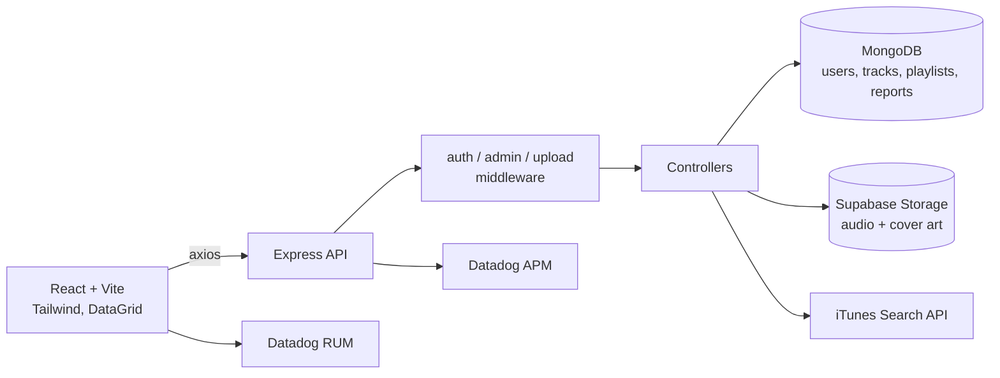

# Vibe Media Player

**A full-stack music player: upload tracks, build playlists, search iTunes, and stream from
object storage.** React front end, Express API, MongoDB metadata, Supabase storage, with
Docker, CI, tracing, monitoring, and load tests around it.

[Live demo](https://media-player-seven-pink.vercel.app) · [Issues](https://github.com/AnushGurung11/Media-Player/issues)


## Features

- **Auth** — email/password (bcrypt + JWT in cookies) and Google OAuth via `@react-oauth/google`.
- **Library** — upload audio files (Multer), read ID3 metadata (`music-metadata`), store the
  file in Supabase and the metadata in MongoDB.
- **Playlists** — create, rename, add/remove tracks, upload cover art.
- **Discovery** — search the iTunes catalogue through a backend proxy.
- **Admin** — user and content moderation views with a separate `adminMiddleware`.
- **Rate limiting** on the API, and structured logs via Winston (optional Loki transport).
- **Observability** — Datadog `dd-trace` in the backend, Datadog RUM in the browser, plus a
  New Relic agent configuration.
- **Load testing** — a Locust suite under `load-tests/`.
- **SonarQube** project configuration (`sonar-project.properties`).

## Architecture



```text
backend/
  config/       Mongo, Google OAuth, Supabase clients
  controllers/  auth, songs, tracks, playlists, admin, iTunes
  middleware/   auth, admin, upload
  models/       User, Track, Playlist, Report
  routes/       one router per resource
  tests/        Jest unit tests (controllers, middleware, models)
frontend/       React 19 + Vite + Tailwind, React Router, Recharts
load-tests/     Locust scenarios
monitoring/     docker-compose for the monitoring stack
jenkins.yml     Jenkins pipeline
```

## Running locally

**Requirements:** Node.js 22+, MongoDB, a Supabase project (or swap the storage client).

```bash
# backend
cd backend
npm install
# .env: PORT, MONGO_URI, JWT_SECRET, GOOGLE_CLIENT_ID, SUPABASE_URL, SUPABASE_KEY
npm run dev

# frontend
cd ../frontend
npm install
npm run dev
```

Environment variables for the backend:

```ini
PORT=5000
MONGO_URI=mongodb://localhost:27017/media-player
JWT_SECRET=change-me
GOOGLE_CLIENT_ID=
SUPABASE_URL=
SUPABASE_KEY=
DD_SERVICE=media-player
```

## Testing

```bash
cd backend
npm test          # Jest unit tests
```

The suite covers the auth controller, iTunes controller, auth/admin middleware, and the
`User` / `Track` models. Run the Locust suite with:

```bash
pip install locust
locust -f load-tests/locustfile.py
```

CI runs the backend tests on every push and pull request to `main`.

## Deployment

Both halves ship separately — the frontend to Vercel, the backend to any Node host or the
included `Dockerfile`. `jenkins.yml` describes the Jenkins pipeline used during development;
GitHub Actions is the pipeline that runs today.

## Known gaps

- The demo instance has no seeded account; register a new one to explore.
- Three open issues cover player state and playlist edge cases — see the issue tracker.
- `load-tests/__pycache__` was committed historically and should be removed.

## License

Not specified. Add one before reuse.
